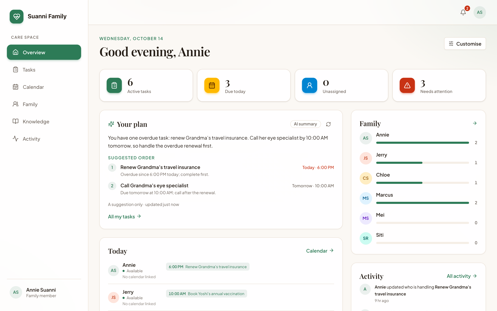
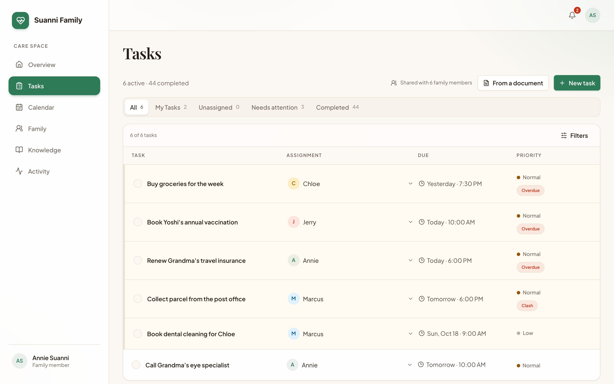
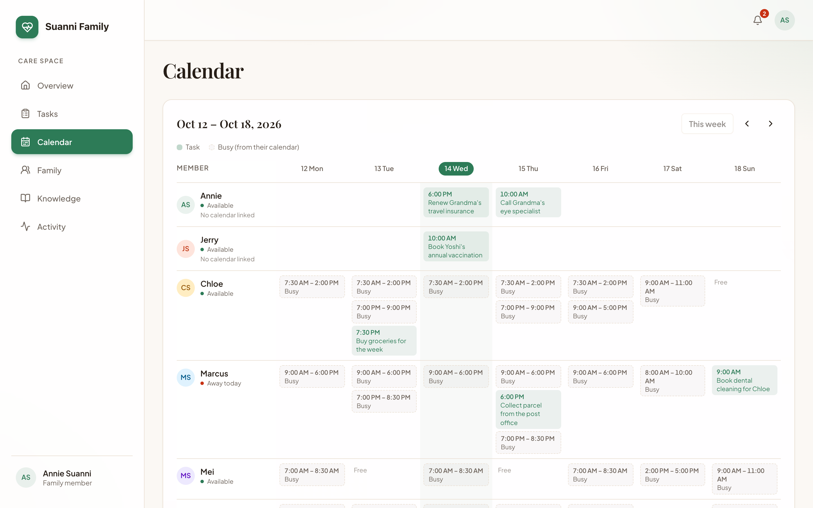
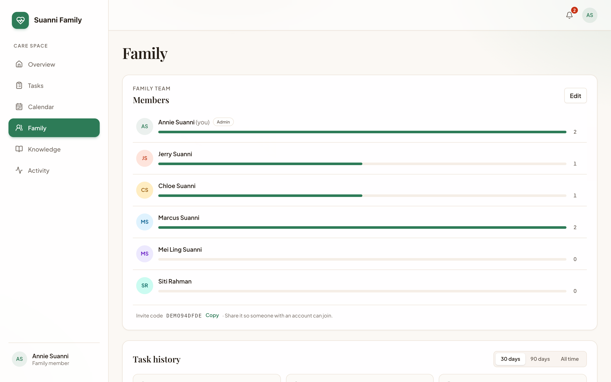
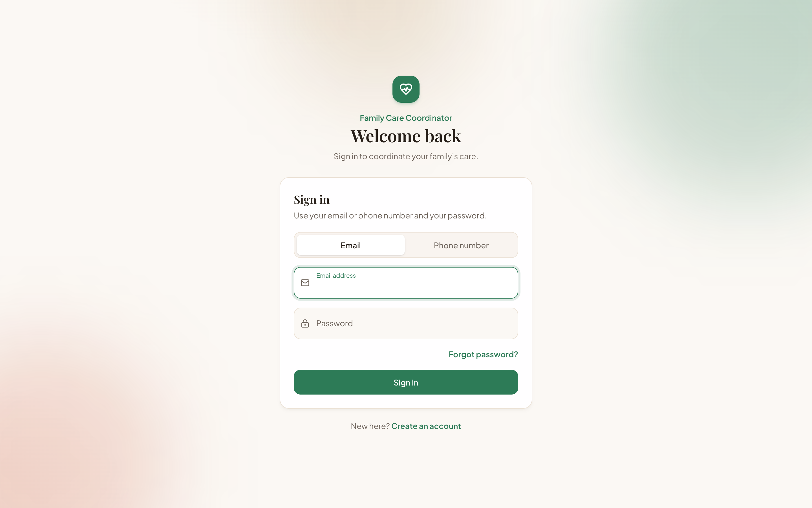

# Family Care Coordinator

**Share the work of caring for a parent fairly, without the group-chat chaos.**

When a family looks after an ageing parent together, the jobs (medication, groceries, appointments, bills) get
scattered across group chats and memory, and the same person ends up doing most of it. Family Care Coordinator puts
every task in one shared place, works out who is best placed to take each one, and reminds people when something is
slipping.



## What it does

**Plan the work together**
- One shared task list for the family, with due times, places, priorities and repeating tasks.
- A calendar showing each person's week: the tasks they hold and, from their linked Apple, Google or Outlook
  calendar, when they are busy.
- An Overview each person arranges for themselves, with a task-history dashboard on the Family page.
- Changes made by one person appear on everyone else's screen within seconds.

**Let AI do the tedious parts**
- **Who should do this?** For each new task the AI suggests a family member, weighing who is free at that time
  (from their calendar), their role (a working-age son before an elderly grandmother), and how much they already
  carry, and explains its choice in one sentence.
- **Tasks from letters.** Upload a school letter, a photo of a notice or a forwarded email, and the AI drafts the
  tasks in it with dates, times and places filled in.
- **Your plan.** Each person gets a short summary of their open tasks in a sensible order.
- **Family notes.** Care notes the family writes ("Linda handles hospital billing") are searched and given to the AI
  when it suggests who should take a task.

**Work from Telegram**
- Forward a message to the family's bot, or mention it in the family group, and it drafts a task to confirm.
- Overdue reminders arrive in Telegram with a **Done** button.
- Notices when someone gives you a task or changes one of yours.

## How the AI is kept safe

- **It proposes; the family decides.** The AI never creates, assigns or completes anything on its own. Every action
  happens when a person presses a button.
- **It can only answer within bounds.** Suggestions are constrained to real members of the family, and people busy at
  the task's time are excluded outright.
- **It never dead-ends.** With no AI key, or the AI service down, assignee suggestions fall back to plain rules and
  the Telegram bot asks for the details one question at a time.
- **Calendars stay private.** Only *when* someone is busy is read from a linked calendar, never what the event is.

## Screenshots

| Tasks | Calendar |
|---|---|
|  |  |

| Family | Sign-in |
|---|---|
|  |  |

## Running it

**You need:** Node.js 20 or newer and Python 3.11 or newer. It was developed on Node 24 and Python 3.14.
No Docker or database server: data is kept in a SQLite file.

**One-time setup**, from the project folder:

```sh
npm install
cd backend
python3 -m venv .venv
.venv/bin/pip install -r requirements.txt
cp .env.example .env
cd ..
```

Then open `backend/.env` and add the keys you want. Both are optional; the app runs without them, with the AI and
the bot switched off.

| Setting | What it turns on | Where to get it |
|---|---|---|
| `OPENAI_API_KEY` | AI suggestions, tasks from documents, the daily plan | [platform.openai.com/api-keys](https://platform.openai.com/api-keys) |
| `TELEGRAM_BOT_TOKEN` | The Telegram bot and overdue reminders | Message `@BotFather` in Telegram and send `/newbot` |

**Start everything** (the backend, the Telegram bot and the app) in one terminal:

```sh
npm run dev:all
```

Open <http://localhost:5173> and create an account. Ctrl+C stops everything.

## Demo mode

Save the data as it is now, with a family you have set up for demos:

```sh
npm run demo:save
```

Before each demo, put it back exactly as it was and start the app:

```sh
npm run demo
```

Dates move forward to match the day you restore, so a task that was due "tomorrow" when you saved is due tomorrow
again on demo day.

## Tests

```sh
cd backend && .venv/bin/python -m pytest      # 192 backend tests
npm run test:e2e                              # 6 browser tests in Chrome
```

The browser tests start their own copy of the app with a throwaway database and no keys, so they never touch your
data or cost anything. They cover signing up and in, creating, completing, editing and deleting tasks, the calendar,
customising the Overview, and two people seeing each other's changes live.

## How it is built

| Part | Technology |
|---|---|
| App | React 19, TypeScript, Vite, Tailwind CSS 4 |
| Server | Python, FastAPI, SQLAlchemy, SQLite |
| AI | OpenAI with structured outputs; ChromaDB with local embeddings to search family notes |
| Calendars | Read-only `.ics` feed links, parsed with `icalendar` |
| Bot | Telegram Bot API, long polling (no public server needed) |
| Tests | pytest, Playwright |

```
src/                 the app
  pages/             one file per page
  components/        shared pieces
backend/app/
  routes/            the API
  services/          the logic: AI, calendars, the Telegram bot, recurring tasks
  models/            the database tables
backend/tests/       backend tests
e2e/                 browser tests
scripts/dev.mjs      starts everything together
```

The API and the backend's settings are described in [backend/README.md](backend/README.md).
